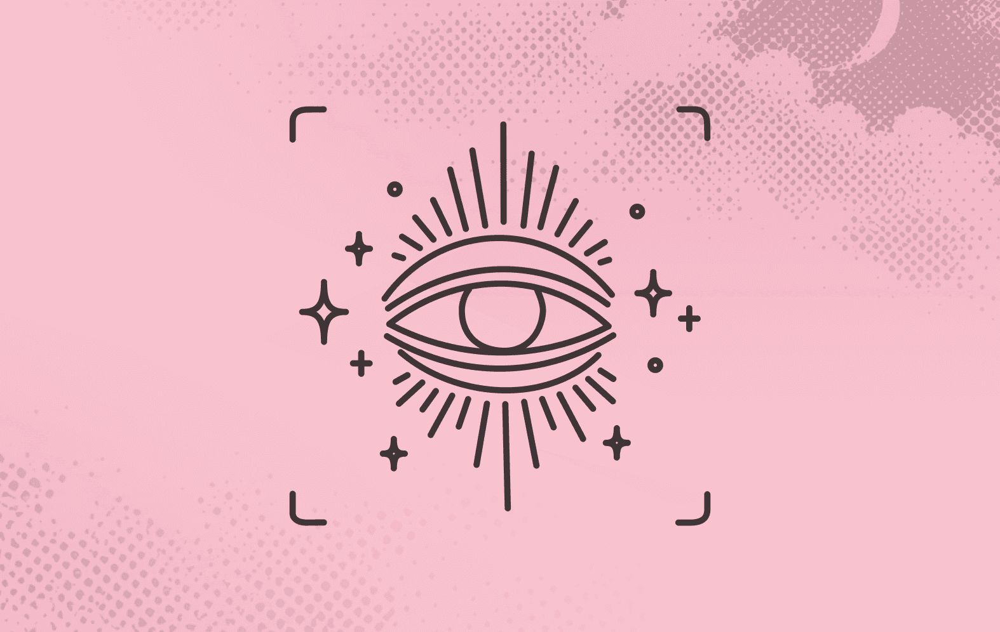
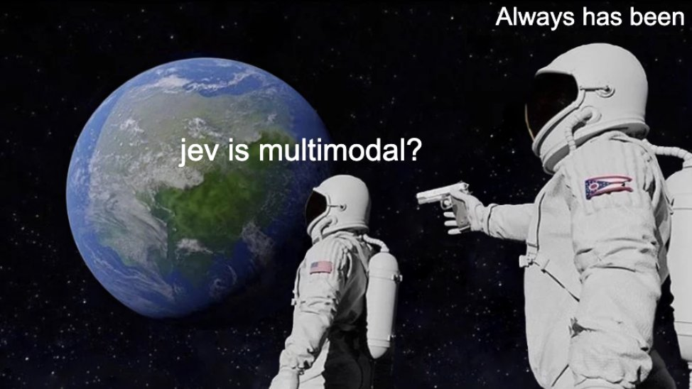
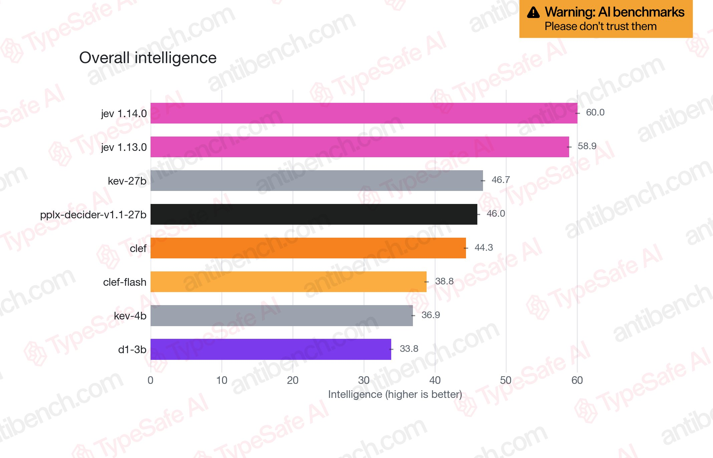
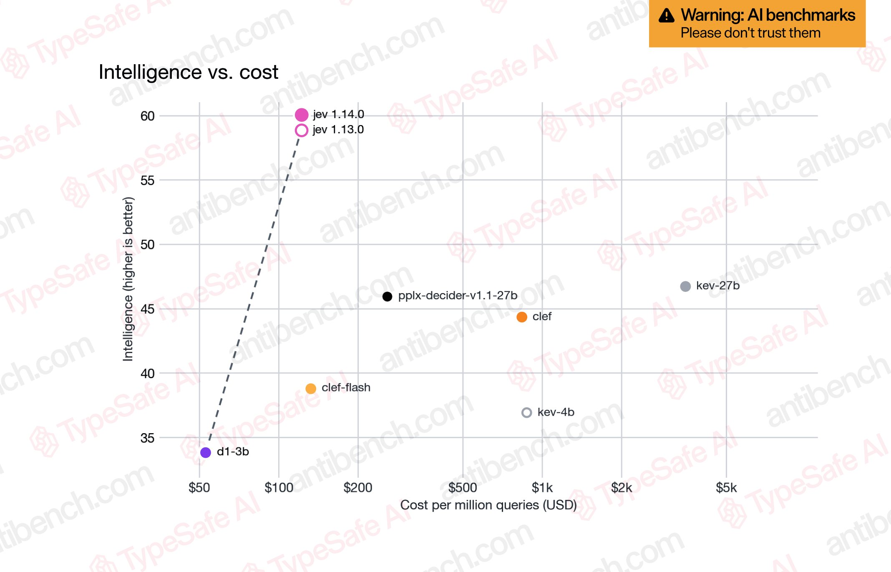
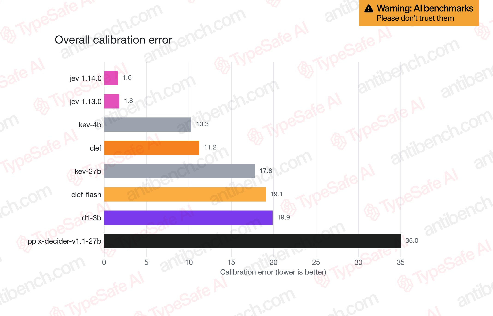

# Jev 1.14.0 开「野区」了：多模态、box 类型与 262k 上下文

> 原文一：[Jev: For the builders AND dreamers](https://typesafe.ai/blog/jev-1-14) · TypeSafe 官方博客 · 2026-10-14
> 原文二：[@CompleteSkeptic 发布推文串](https://x.com/CompleteSkeptic/status/2110488924309348860)（TypeSafe CEO Diogo Almeida，10 条）
>
> 本文为知识库视角的双源合成整理，非官方翻译，版权归原作者所有。



## 作者与来源

**TypeSafe 官方**，2026 年 10 月 14 日（社区称为 "JevDay"）同时发布博客与推文串。推文串作者是 **Diogo Almeida**（@CompleteSkeptic，约 15.5 万粉）——TypeSafe CEO，此前在 OpenAI 期间是 RLHF/ChatGPT 的联合作者之一，简介自称"试图将功赎罪 🤭"。

**证据分级提示**：两个来源是同一信源（厂商自报）。但这次发布有两处罕见姿态：内部评测图带着"Warning: AI benchmarks — Please don't trust them"的水印发布，且官方明说这份衡量"偏向我们自己的模型，别当福音书"。另有一条让本库读者会心一笑的爆料：**"你们熟悉的 Jev（jev-1.13.0）其实一直是多模态模型"**——官方只是把这项能力禁用了。

## 发布哲学：builders 与 dreamers 分道

TL;DR 原文：发布改进版 **jev-1.14.0**，同时给"dreamers"准备了实验特性——**图像、一个新类型、更长的上下文**，原话是"Welcome to the danger zone"，翻成社区黑话就是：野区开门了，进去浪，翻车自负 🔥。

官方的纠结写在开篇：要照顾生产环境的 builders，就该只发内部千锤百炼过的能力；但团队不可能垄断"什么能点燃惊喜"的判断，不该把自己的极端可靠性价值观强加给 dreamers。解法是开**野区**——通过 API 请求头（header）开启的实验特性，相当于游戏里勾选"hardcore 模式"：它们会长期存在、会比市面上现有的更好、还会大幅进化，但官方明确不为生产用例背书。

## 野区三件套

### 1. 可组合图像输入

推文串的原话："**Jev was multimodal all along**"（Jev 从来就是多模态的）——现网 jev-1.13.0 本来就能处理图像，官方只是主动禁用了它，理由是"模型在非文本模态上通常更笨"。

开启方式（请求头）：

```
TypeSafe-Danger-Zone-Images: true
```

图像是**完全可组合**的：JSON 接口支持的地方都能放——state、instructions、甚至 criteria 里。官方同时给了警告：所有模型（Jev 也不例外）的多模态表现弱于纯文本，**把问题拆到最简单的分解形式会好很多**。



### 2. 新类型 box

返回一个**边界框（bounding box）**，不允许类型错误。博客的原话：这是第一个"不只是用来做聪明 if 语句"的类型，是 System One 模型探索"简单决策之外还能做什么"的预览。仅 jev-1.14.0（jev-preview）可用。

### 3. 长上下文解锁（至 262k）

Jev 实际支持的上下文远比生产环境开放的多。官方解释当初限制是故意的：模型在长上下文上更不可靠，这个约束逼出更好的生产用法——"我们不是你爸妈"，但强烈建议继续限制。CEO 的推文补了一刀：最好的产品用例**本该不需要**长上下文，该做的是更用心地管理状态。

```
TypeSafe-Danger-Zone-Long-Context: true
```

## jev-1.14.0 本体

以 **`jev-preview`** 名称提供：不是炫技版，而是各处的小幅改进，官方预期**收益最大的是多语言支持**（推文特意感谢了反馈多语言问题的用户）。发布节奏：`jev-latest` 一周内切换到 1.14.0；jev-1.13.0 继续可用、暂不弃用，正式弃用前会给 60 天预警（1.14.0 是 30 天），弃用政策文档稍后发布。另有一个 opt-in 开关：允许 TypeSafe 用你的查询帮它找模型毛刺（model jaggedness），**仍然不用你的数据训练**。

## 首次公开内部智能评测（"antibench"）

官方第一次晒出内部用来衡量"对开发者最重要的智能形态"的数字。官方自己先泼了四盆冷水：这是我们的最佳猜测、会持续演化、别全信、**大概率偏向我们自己的模型**；只收录开源权重模型（闭源厂商的数据政策会让验证集不保）；专注看开源模型的相对排名就好。







三张图都带同样的"别信"水印与 antibench.com 水印。推文串里还有一句社区互动："Shout outs to the Kev guy!"——榜单里的 kev-27b / kev-4b 是社区模型（本库 33/38 号出现过）。

## 版本切换时间线

| 事项 | 安排 |
|---|---|
| 现在 | jev-1.14.0 以 `jev-preview` 可用；野区三件套可按 header 开启 |
| 一周内 | `jev-latest` 自动切到 1.14.0 |
| 之后 | jev-1.13.0 继续可用；正式弃用前 60 天预警 |
| 预告 | 弃用政策文档；更多"美丽的无聊"式发布（全面小改进、更稳、面向真实部署） |

---

## 译注

- **视觉叙事线在此闭环**。本库此前的记录：官方文档写"Jev 只接受文本，图像音频视频尚不受支持（暂时）"（30 号引过）；23 号 Clef 把"自带视觉编码器"列为与 Jev 拉开差距的第一条；32 号与 38 号证明了"文本训练的决策能力零样本迁移图像"；35 号论文多模态零样本发现（MMBench 82.4%）。现在官方承认 1.13.0 **一直是**多模态、只是禁用——"暂时"两个字兑现了。附带效应：40 号行知里"Jev 不能直接接收相机图片、必须过 RGB-D 检测器"的管线，从此有了官方绕开的可能性。
- **"多模态弱于纯文本、要拆到最简分解"的警告**与 35 号论文的实验结论（多模态零样本可用但需分解）一致；而 **box 类型**则把 System One 从"打分"推进到"定位"——视觉决策的最后一公里（40 号里靠本地检测器做的坐标估计）开始进入官方类型系统。
- **校准误差那张图可能是三张里最硬的**：1.6 对第二名 10.3 是一个量级的差距。本库反复出现的主题——概率本身就是 API（33 号的成本账、35 号的 proper scoring rule、40 号的物理判定依赖置信度）——在这个数字上得到了厂商侧的量化背书。当然，这是自报口径。
- **内部评测发布方式本身是行业稀罕事**：带"别信"水印、自认偏向自家、只比开源模型、强调"用你自己的用例测"。对比 29 号（StartLux 宣传式发布）、38 号（JEV-27B-VL 榜单第一式发布），TypeSafe 选择的是反向操作。数字仍然只能当参考——但它至少把"相对排名"的讨论基础摆了出来。
- **262k 上下文的产品哲学**（"最好的用例不该需要它"）与本库 **24 号**（polydao 的状态压缩）、**16 号**（判断层拆解）一脉相承：决策模型的输入工程比上下文长度更重要。
- 花絮：CEO 的 X 账号叫 CompleteSkeptic（完全怀疑论者），签名"试图将功赎罪"；推文串最后一句是"The Jevolution will not be televised."（玩 Gil Scott-Heron 的梗）。
